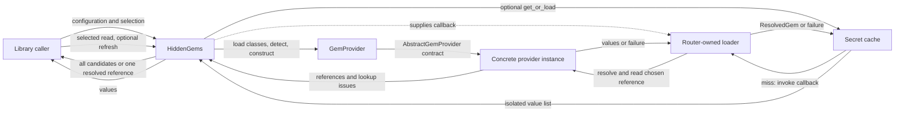
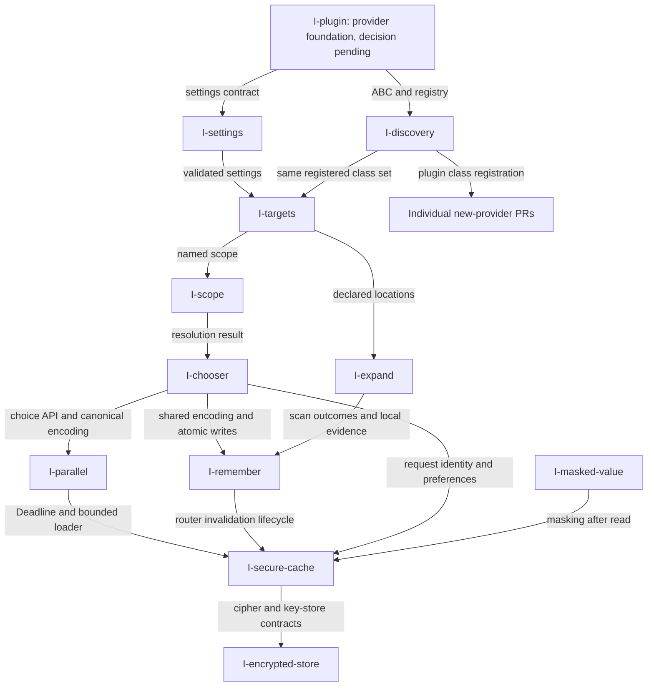

# GAL delivery order

- grounding: GROUNDED
- implementation: PARTIALLY_IMPLEMENTED
- verification: UNVERIFIED
- planningStage: PROPOSED

This is the delivery map for the 38 existing GAL IDs. It distinguishes the existing provider library,
merged specifications, and implementation still to be delivered. It does not approve implementation or
replace the owner's original design. Each GAL remains one bounded delivery judged in its own PR.

## Authority

The source snapshot is main `4641927af1d0bf318c4a64d8ec1ea5ecb60208f4`.
The original requirements remain in [docs/README.md](../README.md); the feature IDs, original order,
interfaces and alternatives remain in [the routing overview](../provider-routing-design.md#feature-index).
Both files are preserved. PRs [#1](https://github.com/spyroot/hiddengems/pull/1),
[#2](https://github.com/spyroot/hiddengems/pull/2), [#3](https://github.com/spyroot/hiddengems/pull/3),
[#4](https://github.com/spyroot/hiddengems/pull/4), [#5](https://github.com/spyroot/hiddengems/pull/5), and
[#6](https://github.com/spyroot/hiddengems/pull/6) merged proposal documents, not their implementations.

This revision applies the owner's request of 2026-10-14 using
[Software Design](https://github.com/spyroot/standards/blob/e48e90da49e647225183d0a17cf6c77dbd5c6cd5/docs/agents/contracts/software-design.md)
and
[System Architecture](https://github.com/spyroot/standards/blob/e48e90da49e647225183d0a17cf6c77dbd5c6cd5/docs/agents/contracts/system-architecture.md).
The SHA is the Standards revision selected for [PR #11](https://github.com/spyroot/hiddengems/pull/11).
The architecture document's stale draft header conflicts with its manifest registration; this plan follows
the owner's explicit adoption of its principles. Classification labels describe the inspected scope;
they do not migrate the binding schema or assert automated classification enforcement.

### Accepted decisions and fixed baseline

- `B` remains `443823457ea17d503add3e7c08e6331cfd7ccf39`, as defined in the overview's abstraction gate.
  Current main and each subsequent approved change are evidence for the delta; neither replaces `B`.
- `put_gem` stays in the existing `AbstractGemProvider`; every concrete provider implements its interface.
  The later owner decision conflicts with the move to `WritableGemProvider` in the frozen overview and
  merged GAL-plugin proposal. That move is not an approved implementation instruction.
- The existing `GemProvider` factory remains the construction and selection boundary. Runtime entry-point
  loading belongs to `GAL-discovery`, not a second factory or a replacement provider abstraction.
- Read-only inputs use `Mapping`; normalized criteria that callers update use `MutableMapping`.
  `_selection` always returns three elements with a fresh mutable mapping third. PR #11 supplies this delta,
  a class-typed registry, `Sequence[Gem]` provider reads, and a public `list[Gem]` result. It is not merged here.
- Return every confirmed reference. A caller chooses among ties; a valid preference is honored; one match
  is sufficient when the selected scope is completely checked. An unchecked relevant location is not absence.
  Whether an unchecked location outside that scope matters remains decision `GAL-unchecked-scope`.
- Detected but inaccessible locations produce UNKNOWN lookup evidence with a reason. Missing SDK access does
  not establish absence. The exact provider-state representation must be settled by `GAL-sdk-optional`.
- Value caching is opt-in. The caller's selection holds for the configured period. An effective preference
  change changes the request; explicit refresh re-reads. Automatic detection of changes made outside this
  library, including in 1Password, is not required and is not a defect in this plan.

## Consumer

A library caller uses `HiddenGems` to obtain all candidate references, select a location, read values, and
write through an explicitly chosen provider. A provider contributor extends `AbstractGemProvider` and
registers through `GemProvider`. CLI users consume non-secret inspection results from the same library.
Each standalone GAL identifies its immediate consumer; a test fixture is not a production consumer.

## Motivation

The library already detects and queries four provider types. The proposed extensions should let callers
configure many instances, retain control of ambiguous results, avoid repeated detection or authentication,
and add providers without duplicating routing logic. The map below ties each benefit to one delivery.
A named class, schema or test directory alone is not a new consumer capability.

## Diagram

Data and control flow for the proposed system:



The cache's loader is supplied by the router and uses factory-created instances; the cache never constructs
providers. Detection memory stores non-secret records separately from the encrypted value cache.
The module decomposition is in each GAL's Diagram section; the existing provider/router modules keep their roles.

## Implementation Plan

PARTIALLY_IMPLEMENTED: the provider abstraction, fixed registry, detection, candidate collection and routing
exist in `src/hiddengems/{abstract_provider,abstraction,gem_provider,hidden_gems}.py` at the source snapshot.
The five standalone proposals add APIs absent from that snapshot: `expand`, deadline-aware calls,
`HiddenGems.invalidate`, remembered detection, and encrypted caching. GAL-plugin already has its base
interface and factory, but its remaining delivery is unresolved after the `put_gem` decision.

Only five of the 38 IDs have detailed proposals. The other entries below point to their current specification
in the frozen overview. Those pointers are evidence of proposed scope, not permission to implement missing
signatures or invent a dependency version. Before their implementation PR, each needs its own bounded
consumer, input/result/error contract, owner/caller map and executable acceptance cases.

### Decisions that prevent a locked delivery

The owner decides these; a recommendation remains a proposal. A conflict blocks only affected work.

| Decision | Affected delivery | Exact unresolved point |
| --- | --- | --- |
| PLUG-01 | GAL-plugin | Keep-base option has types/tests but no new production outcome. |
| RETURN-01 | Provider rollout | `GAL-return-gate` has names, but no complete typed boundary contract. |
| EXPAND-01 | GAL-expand | Select the three alternatives listed in its plan. |
| PARALLEL-01 | GAL-parallel | Select legacy, process, transport, Keychain and mount behavior. |
| REMEMBER-01 | GAL-remember | Select invalidation, reuse, storage and entry-count behavior. |
| CACHE-01 | GAL-secure-cache | Select storage, async consumer and lifecycle alternatives. |
| GAL-explicit-implicit | GAL-scope | Explicit preference wins, conflict, or chooser default? |
| GAL-unchecked-scope | GAL-scope | Which unchecked instances prevent a single result? |
| GAL-return-both | GAL-chooser | References in errors or a returned result; when are values read? |
| GAL-routing | GAL-routing | Approve opt-in narrowing of duplicate search scope. |
| GAL-secret-mapping | GAL-routing | Static selector or name-pattern mapping? |
| GAL-kube-extra | GAL-sdk-optional | Move Kubernetes SDK to an installation extra? |
| GAL-masked-value-api | GAL-masked-value | Opt-in masking and treatment of every supported Gem variant. |

PLUG-01: retaining the required base interface is settled. The implementation outcome is not. The owner can
retain this GAL as a separately requested contract delivery, or fold its foundation into the first consuming
capability. Neither changes `put_gem`. This plan does not silently move runtime loading out of GAL-discovery.

RETURN-01: the existing proposed owner is `src/hiddengems/contract_check.py`, with `check_detected`,
`check_references`, `check_values` and `check_reference`. Their consumers are the factory and router at the
`detect`, `find_gem`, `get_gem`, `put_gem` and partial-error boundaries. The required outcome is rejection of
undeclared record shapes, identity mismatches and invalid fields before use. The exact accepted schemas,
provider-specific metadata extension mechanism, exception contract and cases remain unspecified. PR #11's
scalar string/bytes check is implemented on its branch; it does not satisfy this whole requirement.
Do not turn arbitrary secret dictionary contents into a closed metadata schema.

### Shared design rules applied to these plans

The overview's abstraction-extension gate remains the gate: `C = B + explicitly approved delta`.
Every extension must have a concrete signature, behavior, owner, actual caller and acceptance case.
Providers implement required members; optional hooks need a specified inherited default.
Construction stays in the factory, shared mechanisms have one owner, and core abstractions do not dispatch
on concrete provider names. A new abstraction needs authorized variation and a real consumer.

Synchronous and asynchronous execution are separate contracts. Deadlines describe both caller return and
resource lifetime; cancelling a future does not establish that underlying work ended. Cached detection,
provider-owned state, caller preferences, and encrypted values have different owners and invalidation rules.
The standalone plans retain their exact record, storage and concurrency specifications for review.

## PR Order

`I-<GAL suffix>` is a proposed delivery slot, not a GitHub number or implementation authorization.
The five linked proposals have detailed contracts but remain decision-required. The other 33 rows are
ordered backlog entries marked **proposal required**: the cited
[overview specification](../provider-routing-design.md#10-specification) does not yet supply their
complete owner, caller, input/result/error contract and acceptance map. Their table cells describe the
intended outcome, not a locked implementation specification.
`W0`–`W7` are proposed merge waves, not new phase IDs, priority changes, or permission to implement.
Within a wave, a row may start only when its actual inputs exist. Independent rows need not wait for each other.

| Wave / delivery slot | Intended consumer-visible delivery | Required input | Specification status |
| --- | --- | --- | --- |
| W0 / I-readme-frozen | Reject an unapproved design edit | Owner hash; explicit check request | Proposal required |
| W0 / I-lint-clean | Contributor gets clean static checks | Existing bless and Ruff profiles | Proposal required |
| W1 / I-plugin | [Provider foundation](GAL-plugin.md) | PR #11; PLUG-01 | Decision required: PLUG-01, RETURN-01 |
| W1 / I-settings | Reject invalid provider settings | Provider foundation | Proposal required |
| W1 / I-selector | Reject invalid lookup criteria | Provider foundation | Proposal required |
| W1 / I-discovery | Load registered plugin classes | Provider foundation; settings check | Proposal required |
| W1 / I-sdk-optional | Report missing access dependencies | Provider foundation; SDK decision | Proposal required |
| W2 / I-targets | Load named targets without rewriting v1 | Settings checks and class loader | Proposal required |
| W2 / I-expand | [Expand declared paths](GAL-expand.md) | Targets, discovery, settings, states | Decision required: EXPAND-01 |
| W2 / I-local-off | Disable implicit local discovery | Target config `discovery_local` | Proposal required |
| W2 / I-kube-contexts | Enumerate selected file contexts | Expanded local kubeconfig files | Proposal required |
| W3 / I-scope | Resolve selected scope consistently | Named targets; scope decisions | Proposal required |
| W3 / I-routing | Route a gem name to selected targets | Scope; routing decisions | Proposal required |
| W3 / I-chooser | Caller selects and remembers a reference | Scope; candidate representation | Proposal required |
| W3 / I-explain | Explain routing without reading values | Scope; provider observations | Proposal required |
| W3 / I-write-target | Write through a named target | Targets; required base `put_gem` | Proposal required |
| W4 / I-parallel | [Bound concurrent lookup](GAL-parallel.md) | Chooser, scope, settings, factory | Decision required: PARALLEL-01 |
| W4 / I-cli-detect | CLI prints detection metadata | Provider contract; CLI entry point | Proposal required |
| W4 / I-cli-targets | CLI prints target catalog | Targets; CLI entry point | Proposal required |
| W4 / I-cli-explain | CLI prints routing explanation | Explain API; CLI entry point | Proposal required |
| W4 / I-cli-validate | CLI checks a config document | Config loader; CLI entry point | Proposal required |
| W4 / I-cli-init | CLI emits or explicitly writes config | Target config; CLI entry point | Proposal required |
| W5 / I-remember | [Reuse detection records](GAL-remember.md) | Chooser I/O, targets, expansion | Decision required: REMEMBER-01 |
| W5 / I-verify | Caller explicitly verifies a target | Named targets; verification contract | Proposal required |
| W5 / I-cli-verify | CLI prints active verification result | Verify API; CLI entry point | Proposal required |
| W5 / I-masked-value | Opt-in masked display of values | Full Gem coverage; masking decision | Proposal required |
| W6 / I-secure-cache | [Reuse encrypted values](GAL-secure-cache.md) | Parallel, remember, chooser, masking | Decision required: CACHE-01 |
| W7 / I-secret-service | Linux credential access | Provider and discovery contracts | Proposal required |
| W7 / I-wincred | Windows credential access | Provider and discovery contracts | Proposal required |
| W7 / I-vault | Vault KV v2 access | Provider contract; target settings | Proposal required |
| W7 / I-aws-secrets | AWS Secrets Manager access | Provider contract; profile and region | Proposal required |
| W7 / I-aws-ssm | AWS Parameter Store access | Provider contract; profile and region | Proposal required |
| W7 / I-gcp-secrets | GCP Secret Manager access | Provider contract; declared project | Proposal required |
| W7 / I-azure-keyvault | Azure Key Vault access | Provider contract; declared vault | Proposal required |
| W7 / I-sops | Read declared SOPS files | Provider contract; executable adapter | Proposal required |
| W7 / I-encrypted-store | Encrypted local provider | Secure-cache cipher/key contracts | Proposal required |
| W7 / I-pass | Read pass/gopass entries | Provider contract; executable adapter | Proposal required |
| W7 / I-bitwarden | Read Bitwarden CLI entries | Provider contract; executable adapter | Proposal required |

The I-plugin foundation and every dependency on it remain decision-required until PLUG-01 names its
bounded outcome. A proposed wave does not satisfy that dependency.

Every W7 row also requires discovery registration and an approved provider-specific contract; the shortened
input cells do not remove those shared requirements. Each declares exact library calls and version bounds,
passive detection evidence, settings, supported reads/writes and failure cases before implementation.
No new provider, SDK, CLI command or configuration policy is implemented by this planning change.



The graph highlights shared artifacts, not every prerequisite; the table and each GAL's dependency section
supply the remaining edges. Parallel and remember may proceed independently after those edges are satisfied.
CLI rows depend on their library API and the common CLI entry point, not on every preceding CLI command.

## Gates

The following is the canonical cross-GAL map. Detailed per-GAL requirements map to cases in each proposal.
All new implementation gates below are **proposed**, not evidence that the code or enforcement exists.

| Requirement | Owning delivery / evidence | Acceptance |
| --- | --- | --- |
| R-BASE | Every GAL; fixed B and explicit delta | Abstraction-extension gate; all P conform |
| R-TYPES | PR #11; provider/router boundary | Fixed mutable tuple; sequence/list cases |
| R-RETURNS | RETURN-01; factory/router | Complete typed return contract and cases |
| R-CHOICE | Scope and chooser | Preserve every candidate and honor selection |
| R-UNKNOWN | SDK-optional and scope | Inaccessible does not become absent |
| R-REUSE | Every GAL's module/owner map | One shared owner; no parallel factory |
| R-LIFETIME | Parallel, remember, secure-cache | Deadlines, cancellation, release, retirement |
| R-FROZEN | This plan revision | Both original design blobs unchanged |
| R-DELIVERY | Each I-* row | Observable result plus its own accepted spec |

The source snapshot has no implemented `tests/contract/` kit, `pattern_walk.py`, `detection_cache.py`,
`secret_cache.py`, or `DeadlineAwareGemProvider`. Their acceptance names are commitments for their
implementation PRs. Existing routing, dotenv, Keychain and wheel tests remain the baseline evidence surface.

Existing GitHub validation is introduced by PR #11 and uses one Python 3.11/macOS job. Its topology is:

```text
candidate SHA -> Conda environment -> workflow checks
                                  -> Ruff lint -----------+
                                  -> Ruff format ---------+-> job result -> merge decision
                                  -> pytest + wheel checks+
```

These steps are sequential in that job; failure conditions still allow later Python checks to report.
All required results must pass for that candidate. The implementation PR adds its behavioral cases to the
existing pytest surface. Required Markdown/spelling checks are not wired into that workflow; this planning
change neither adds a new checker nor claims that missing enforcement exists.

No test result from PR #11 proves any unimplemented GAL. Merging this map or a proposal does not settle its
remaining owner decisions. A contradictory contract section, missing concrete caller, undefined return shape,
or unselected behavior branch prevents that affected GAL from being called locked.
